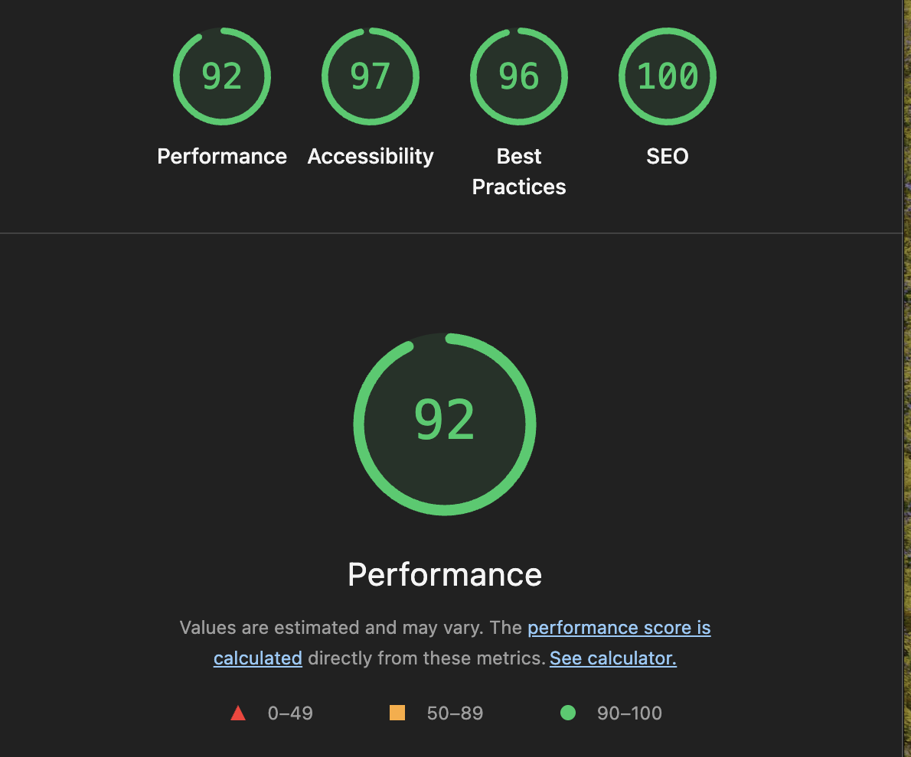

# Lighthouse Audit Report

## Audit information

- **Project:** FlavorCraft Labs
- **Tool:** Google Lighthouse (Chrome DevTools)
- **Device:** Mobile and Desktop

| Date            | Audit                                                        | Environment                                  | Pages tested               |
| --------------- | ------------------------------------------------------------ | -------------------------------------------- | -------------------------- |
| 16 October 2026 | Initial baseline                                             | Local Next.js production build               | `/`, `/login`, `/register` |
| 21 October 2026 | Follow-up performance investigation and independent QA audit | Local build and deployed Netlify application | `/`                        |
| 22 October 2026 | Final production verification                                | Netlify deploy of the `develop` branch       | `/`                        |

## Current Status Summary

Status of each finding, based on the final production audit (22 October 2026) and the code on `develop` (updated 23 October 2026).

| Finding                                   | Ticket / PR    | Status                                                                                                             |
| ----------------------------------------- | -------------- | ------------------------------------------------------------------------------------------------------------------ |
| Slow server response                      | #229           | Partly fixed: recipe list cached for 60 seconds, but the final audit still flags server response time (700–900 ms) |
| Render-blocking Adobe Fonts               | #232 (PR #258) | Partly fixed: preconnect hints added. The stylesheet still blocks rendering (about 770 ms on mobile)               |
| Missing category routes (404)             | –              | Fixed: category links now go to `/recipes?filters=category:…`. No console errors in the final audit                |
| Third-party cookies and DevTools issues   | –              | Fixed: both audits pass in the final audit                                                                         |
| Hero images preloaded and both downloaded | –              | Open: confirmed in the final audit. Likely cause: `priority` on both images                                        |
| Oversized external recipe images          | –              | Open: deferred. About 6,000 KiB estimated savings in the final audit                                               |
| Insufficient color contrast               | –              | Fixed after the final audit (PR #273, 22 Oct). Mobile Accessibility re-measured at 100 on 23 Oct                   |

**Final scores (homepage, 22 October 2026):** Mobile Performance 86.3 (average of three runs: 84, 86, 89), Accessibility 97, Best Practices 96, SEO 100. Desktop Performance 98, Accessibility 97, Best Practices 100, SEO 100. See [section 7](#7-final-production-lighthouse-verification--22-october-2026).

## Homepage Initial Baseline scores

| Category       | Mobile Score | Desktop Score |
| -------------- | ------------ | ------------- |
| Performance    | 46           | 99            |
| Accessibility  | 97           | 97            |
| Best Practices | 69           | 69            |
| SEO            | 100          | 100           |

### Homepage Mobile Audit Reliability

Three mobile Lighthouse audits were performed.

| Run         | Performance | Accessibility | Best Practices | SEO |
| ----------- | ----------: | ------------: | -------------: | --: |
| Initial     |          46 |            97 |             69 | 100 |
| Incognito 1 |          83 |            97 |             96 | 100 |
| Incognito 2 |          89 |            97 |             92 | 100 |

Both Incognito runs reported that the page exceeded
Lighthouse's loading time limit and that results
might be incomplete.

**Note on saved reports:** The saved mobile report from 16 October
(`lighthouse-reports/homepage-mobile-2026-10-16.html`) comes from
another run in the same session and shows a Performance score of 66.
The reports for the runs in the table above were not saved. The
baseline of 46 is kept as recorded, and the spread between 46 and 89
on the same day is part of why this baseline is treated as provisional.

Performance and Best Practices scores varied
significantly between runs.

**Status:** Provisional baseline. Further investigation
is required before drawing conclusions about performance.

**Follow-up:** Repeat the audit under consistent conditions
once core functionality is complete. Investigate whether
third-party resources or network activity contribute to
the loading timeout.

### Initial Comparison

The homepage achieved a significantly higher Performance score
on Desktop (99) than Mobile (46).

Accessibility and SEO scores were consistently high across
both device configurations.

Best Practices scored 69 on both, indicating that further
investigation is needed.

Mobile performance is the main optimization concern,
particularly Total Blocking Time, Speed Index, and image delivery.

Performance improvements will be reviewed after core
application functionality is complete.

## Audit Scope and Limitations

This initial audit was conducted using a local Next.js production build on 16 October 2026.

At the time of testing, the application was under active development, and some routes and features had not yet been completed.

These findings represent the initial performance and technical SEO baseline rather than the final assessment of the application.

Final production Lighthouse results from 22 October 2026 are documented in Section 7.

## Performance

### Mobile Baseline Score: 46

| Metric                         | Result   | Assessment        |
| ------------------------------ | -------- | ----------------- |
| First Contentful Paint (FCP)   | 2.7 s    | Needs improvement |
| Largest Contentful Paint (LCP) | 3.8 s    | Needs improvement |
| Total Blocking Time (TBT)      | 2,430 ms | Poor              |
| Cumulative Layout Shift (CLS)  | 0        | Good              |
| Speed Index                    | 15.6 s   | Poor              |

### Initial Assessment

The most significant concerns are Total Blocking Time and
Speed Index, indicating substantial main-thread blocking
and slow visual loading under simulated mobile conditions.

LCP also requires investigation to identify whether the
homepage's hero image or another element is responsible.

No layout shifts were detected during the audit.

### Performance Insights

The initial mobile Lighthouse audit identified several
potential optimization opportunities.

| Finding                             | Estimated Savings | Status                                     |
| ----------------------------------- | ----------------- | ------------------------------------------ |
| Improve image delivery              | 1,932 KiB         | Findings documented; optimization deferred |
| Legacy JavaScript                   | 13 KiB            | Investigation pending                      |
| Font display                        | 50 ms             | Investigation pending                      |
| Render-blocking requests            | 20 ms             | Investigation pending                      |
| Forced reflow                       | Not specified     | Investigation pending                      |
| LCP breakdown and request discovery | Not specified     | Investigation pending                      |
| Network dependency tree             | Not specified     | Investigation pending                      |

#### Initial Recommendations

- Investigate image sizes, formats, and responsive image delivery.
- Review whether desktop and mobile hero images are both
  being unnecessarily preloaded.
- Identify the element responsible for LCP.
- Investigate JavaScript execution and forced reflows
  contributing to main-thread blocking.

**Note:** These are initial Lighthouse findings.
Root causes and actual performance improvements
have not yet been verified.

### Image Delivery

**Finding:** Lighthouse identified approximately 1,932 KiB
of potential image transfer savings on mobile.

The majority of the affected images are externally hosted
recipe images.

| Image Source          | Estimated Savings |
| --------------------- | ----------------: |
| postimg.cc            |         857.3 KiB |
| Unsplash              |         514.5 KiB |
| MatPrat               |         280.1 KiB |
| Food & Wine           |         154.7 KiB |
| H2Q Shop              |          90.4 KiB |
| Local category images |          34.8 KiB |

#### Observations

- Several recipe images are substantially larger than
  their displayed dimensions.
- Some images could benefit from modern formats or
  increased compression.
- Externally hosted recipe images account for most of
  the estimated savings.

#### Recommendations

- Review recipe card image rendering.
- Consider Next.js Image optimization with responsive
  image sizes.
- Serve smaller image variants where supported.
- Verify that external image sources are compatible
  with the chosen optimization approach.

**Technical impact:** High potential for reducing image transfer size.

**Implementation priority:** Deferred until core functionality
and recipe details are complete.

**Status:** Lighthouse finding documented.
Optimization not yet implemented.

**Follow-up:** Review with the recipe card developer (Thea) once
core functionality is complete. Repeat the mobile audit
after improvements.

### Status

Baseline recorded. Root causes have not yet been confirmed.

## Best Practices

### Mobile Baseline Score 69/100

The initial Lighthouse audit identified the following areas for further investigation:

- Third party cookies (3 detected)
- Browser console errors
- Chrome DevTools Issues panel warnings
- Low-resolution images
- Security recommendations involving CSP, HSTS, COOP, clickjacking protection, and Trusted Types.

### Status

The audit confirmed missing category routes and identified image preload warnings. Other findings require further investigation to determine whether they represent application defects or deployment-related configuration issues.

**Status update (22 October 2026):** Best Practices scored 96 on mobile and 100 on desktop in the final audit. The browser console errors (category 404s), third-party cookies and DevTools Issues panel audits all pass.

### Next Steps

- Inspect browser console errors
- Identify third party cookie sources
- Review image resolution warnings
- Coordinate security-header recommendations with the development team.
- Recheck applicable findings on the deployed website.

### Browser Console Findings

#### Missing Category Routes

**Finding:** Requests to six category routes return HTTP 404.

**Affected routes:**

- `/categories/breakfast`
- `/categories/lunch`
- `/categories/dinner`
- `/categories/snack`
- `/categories/dessert`
- `/categories/drink`

**Possible cause:** Category pages have not yet been implemented
or merged into the current branch.

**Recommendation:** Verify that category routes are implemented
before final deployment. Recheck once the category pages are available.

**Status:** Pending development verification.

**Status update (22 October 2026):** Resolved. The `/categories/*` pages were not built. Instead, `CategoryNavigation` now links to the recipes page with a category filter (for example `/recipes?filters=category:breakfast`), so these requests no longer occur.

#### Unused Image Preloads

**Finding:** Chrome reports that the desktop and mobile hero
images were preloaded but not used shortly after page load.

**Affected resources:**

- `Header-Image-Desktop.png`
- `Header-Image-Mobile.png`

**Potential impact:** Unnecessary preloading may increase
network activity and affect page performance.

**Recommendation:** Review responsive image rendering and
preloading behavior. Verify which images are actually downloaded.

**Status:** Investigation pending.

**Status update (22 October 2026):** Likely cause identified, not fixed. See [section 4](#4-responsive-hero-image-loading).

## Accessibility

### Baseline Scores

- Mobile: 97/100
- Desktop: 97/100

### Identified Issue: Insufficient Color Contrast

**Finding:** Lighthouse identified foreground and background
color combinations that do not meet minimum contrast requirements.

**Impact:** Text may be difficult to read for users with
visual impairments.

**Recommendation:** Identify the affected elements and adjust
their colors to meet WCAG contrast requirements.

#### Affected Elements

Lighthouse identified two recurring color combinations
that fail its contrast audit:

1. Small uppercase text (`text-basil-300`) within a
   section using `bg-salt-500`.
2. Recipe card descriptions (`text-oat-800`) displayed
   on white card backgrounds (`bg-white`).

The recipe card issue occurs repeatedly because the
same styling is used across multiple cards.

#### Recommendations

- Verify the actual contrast ratios of the affected colors.
- Adjust text colors to meet WCAG AA contrast requirements
  (at least 4.5:1 for normal text).
- Reuse accessible color tokens across shared components.
- Rerun Lighthouse after the styling changes.

**Status:** Confirmed accessibility finding; fix pending.

**Implementation priority:** Address before final QA and
submission, without delaying completion of core functionality.

**Follow-up:** Share findings with the relevant developers
once the recipe details page is complete.

**Status update (23 October 2026):** Fixed in PR #273, merged after the final audit. See [the update below](#final-production-accessibility-verification--22-october-2026).

### Final Production Accessibility Verification — 22 October 2026

**Environment:** Netlify deploy of the `develop` branch  
**Page tested:** Homepage (`/`)  
**Accessibility score:** 97/100 (Mobile and Desktop)

The final production Lighthouse audits continued to identify insufficient color contrast.

The affected elements match those documented during the initial baseline audit:

1. **Hero section:** Small uppercase text using `text-basil-300` against `bg-salt-500`.
2. **Recipe cards:** Description text using `text-oat-800` against `bg-white`.

These findings were confirmed by inspecting the failing elements in the Lighthouse Accessibility report.

Although the Accessibility score remained consistently high at 97/100, the identified contrast issues have not been resolved.

**Status:** Confirmed in production; unresolved at the time of final verification.

**Recommendation:** Adjust the affected text or background colors to meet WCAG AA contrast requirements (minimum 4.5:1 for normal text), then rerun the accessibility audit to verify the changes.

**Conclusion:** The final Lighthouse audit confirms that the application maintains a high Accessibility score, but additional color contrast improvements are required.

**Status update (23 October 2026):** Fixed in PR #273, which was merged after the final audit. Both affected text colors were changed to darker design tokens, and the new contrast ratios were calculated from the color values in `globals.css`:

| Element                              | Before                             | After                              | WCAG AA (4.5:1) |
| ------------------------------------ | ---------------------------------- | ---------------------------------- | --------------- |
| Hero label (`bg-salt-500`)           | `text-basil-300` (#628d78): 3.44:1 | `text-basil-400` (#44775d): 4.76:1 | Passes          |
| Recipe card description (`bg-white`) | `text-oat-800` (#807d74): 4.11:1   | `text-nori-400` (#434d48): 8.77:1  | Passes          |

**Re-measured (23 October 2026):** A mobile Lighthouse audit of the homepage on the `develop` deployment scored Accessibility **100/100**, up from 97, and the color contrast audit now passes. The same run scored Performance 88, Best Practices 96 and SEO 100. Desktop was not re-measured. Report: [homepage-mobile-2026-10-23.html](lighthouse-reports/homepage-mobile-2026-10-23.html).

## Additional Page Audits

### Registration Page (`/register`)

| Category       | Mobile | Desktop |
| -------------- | -----: | ------: |
| Performance    |     91 |     100 |
| Accessibility  |     96 |      96 |
| Best Practices |    100 |      96 |
| SEO            |    100 |     100 |

**Assessment:** All categories scored above 90 on both
devices. Accessibility findings should be reviewed
before final QA.

**Status:** Initial baseline completed.

### Login Page (`/login`)

| Category       | Mobile | Desktop |
| -------------- | -----: | ------: |
| Performance    |     93 |     100 |
| Accessibility  |     96 |      96 |
| Best Practices |    100 |      96 |
| SEO            |    100 |     100 |

**Assessment:** All four categories scored above 90 in the clean-session mobile audit and desktop audit.

**Testing note:** An earlier mobile run scored 63 and reported potentially interfering IndexedDB data. The Incognito retest scored 93. Performance results can vary between runs.

**Status:** Initial baseline completed. Remaining accessibility findings should be reviewed before final QA.

## Follow-up Performance Investigation — 21 October 2026

### Overview

Following the initial Lighthouse baseline audit on 16 October 2026, additional investigations were conducted to identify potential causes of slow mobile performance.

The investigation focused on server response time, render-blocking font resources, image delivery, and responsive hero image loading.

The findings were documented and communicated to the development team through GitHub tickets.

### 1. Slow Server Response

**Finding:** Lighthouse reported a document response time of approximately 797 ms, with an estimated improvement opportunity of 700 ms.

**Investigation:**

The homepage server component (`src/app/page.tsx`) performs asynchronous operations to retrieve recipe data and authentication-related information.

The implementation currently awaits `fetchRecipes()` and `getAccessToken()` sequentially.

The recipe API request in `src/app/lib/recipe.ts` does not explicitly configure Next.js fetch caching.

These observations identify areas worth investigating, but do not independently establish the cause of the server response delay. API latency, authentication processing, and deployment infrastructure may also contribute.

**Recommendations:**

- Profile server-side operations to identify the main source of latency.
- Review whether independent asynchronous operations can execute concurrently.
- Evaluate appropriate caching strategies for publicly available recipe data.
- Compare response times before and after changes.

**GitHub ticket:** #229 — Fix Slow Server Response  
**Priority:** P1  
**Status:** Reported to development team; optimization not yet verified.

**Status update (22 October 2026):** Fixed in #229. `fetchRecipes()` now caches the recipe list for 60 seconds (`next: { revalidate: 60 }`). The developer measured homepage TTFB going from about 0.27 s to 0.09 s on a local production build. The homepage also no longer calls `getAccessToken()` directly; login state is read further down the component tree. Header components still read the session cookie, so pages are still rendered dynamically. The final audit on 22 October still flagged server response time: the root document took 700–850 ms on mobile and 900 ms on desktop. Caching the recipe data alone did not make this audit pass on the deployed site.

### 2. Render-Blocking Adobe Fonts

**Finding:** Lighthouse identified render-blocking font-related resources, including an Adobe Typekit stylesheet.

**Affected resources:**

- `use.typekit.net/xnz3twu.css`
- Resources loaded through `p.typekit.net`

**Investigation:**

The root layout (`src/app/layout.tsx`) loads an external Adobe Fonts stylesheet.

The application also uses Next.js font loading for Inter.

The external stylesheet introduces an additional dependency during initial page rendering.

Lighthouse reported approximately 770 ms associated with the identified stylesheet request and an estimated render-blocking improvement opportunity of approximately 930 ms.

These figures are diagnostic estimates rather than confirmed savings.

**Recommendations:**

- Review whether all externally loaded font families and weights are necessary.
- Investigate whether the stylesheet can be loaded in a less render-blocking manner.
- Evaluate suitable font-loading alternatives while preserving the approved visual design.
- Rerun Lighthouse after any changes.

**GitHub ticket:** #232 — Fix Adobe Fonts  
**Status:** Reported to development team; optimization not yet verified.

**Status update (22 October 2026):** Partly fixed in PR #258. `layout.tsx` now has `preconnect` hints for `use.typekit.net` and `p.typekit.net`, so the browser connects to the font servers earlier. The Typekit stylesheet is still loaded as a normal, render-blocking stylesheet.

### 3. External Recipe Image Optimization

**Finding:** Lighthouse identified substantial potential transfer savings from oversized recipe images.

A subsequent audit reported approximately 2,308 KiB of potential image savings.

**Investigation:**

Many recipe images are hosted externally and supplied through the recipe API.

The shared `RecipeImage.tsx` component already uses Next.js `<Image>`, including the `fill` property.

However, the component uses `unoptimized`, meaning Next.js does not automatically resize or compress these images through its image optimization pipeline.

Therefore, simply replacing standard HTML images with Next.js `<Image>` would not resolve the underlying issue.

**Recommendations:**

- Investigate whether supported external image hosts can provide appropriately sized images.
- Evaluate a controlled image optimization or proxy strategy.
- Consider responsive image delivery and suitable image formats.
- Preserve fallback handling for missing or broken recipe images.
- Assess implementation complexity against the remaining project timeframe.

**Status:** Finding documented; optimization deferred.

**Limitation:** No verified reduction in image transfer size has been recorded.

**Status update (22 October 2026):** Unchanged. `RecipeImage.tsx` still uses `unoptimized`.

### 4. Responsive Hero Image Loading

**Finding:** Both desktop and mobile homepage hero images were downloaded during mobile testing.

**Affected resources:**

- `Header-Image-Mobile.png`
- `Header-Image-Desktop.png`

**Investigation:**

Chrome DevTools Network inspection confirmed requests for both images on a mobile viewport.

The observed transfer sizes were approximately:

- Mobile hero image: 9.5 KB
- Desktop hero image: 21.0 KB

Although the transferred files are relatively small, downloading both images introduces unnecessary network activity.

The investigation also identified hero image preload behavior as a potential optimization opportunity.

Lighthouse's LCP request discovery diagnostics indicated that the mobile hero image was not being prioritized as expected.

**Recommendations:**

- Review responsive hero image rendering and preload configuration.
- Ensure the browser prioritizes the image appropriate to the current viewport.
- Avoid unnecessary downloads of images intended for other viewport sizes.
- Recheck Largest Contentful Paint and network requests after changes.

**Status:** Duplicate mobile downloads confirmed; optimization not yet verified.

**Status update (22 October 2026):** Confirmed again in the final audit: both hero images are downloaded on mobile and desktop. Likely cause identified, not fixed. In `HeroSection.tsx`, both the mobile and the desktop image have the `priority` prop. With `priority`, Next.js preloads an image even when CSS hides it (`md:hidden` / `hidden md:block`), so both images are requested on every viewport. Possible fixes are to keep `priority` on only one image, or to use one `<picture>` element with `getImageProps()` (art direction) so the browser downloads only the image for the current viewport.

### 5. Development Follow-up

The following tickets were created to communicate relevant issues to the development team:

| Ticket | Description              | Category           |
| ------ | ------------------------ | ------------------ |
| #229   | Fix Slow Server Response | Performance        |
| #232   | Fix Adobe Fonts          | Performance        |
| #228   | Fix Sticky Navbar        | Usability / UI     |
| #243   | Fix Favorites            | Functionality / UX |

The server response and font-loading tickets address performance findings investigated during the Lighthouse follow-up.

The sticky navbar and Favorites tickets address separate usability and functionality concerns.

**Status update (23 October 2026):** All four tickets have been worked on and merged into `develop`: #229 (PR #242), #232 (PR #258), #228 (PR #235) and #243 (PR #257). The hero image and external image findings do not have their own tickets.

### 6. Overall Assessment

The follow-up investigation identified several opportunities to improve mobile performance.

The most significant areas for further technical review are:

- Server-side response time and data fetching.
- Render-blocking external font resources.
- Oversized externally hosted recipe images.
- Responsive hero image loading and prioritization.

These findings have been documented, and relevant issues have been communicated to the development team.

**Status:** Investigation and reporting completed. Performance improvements remain subject to developer implementation and subsequent verification.

### 7. Final Production Lighthouse Verification — 22 October 2026

**Environment:** Netlify deploy of the `develop` branch (`https://develop--flavorcraftlabs.netlify.app/`)  
**Page tested:** Homepage (`/`)  
**Device configurations:** Mobile and Desktop (Lighthouse default simulated throttling)  
**Tool:** Google Lighthouse 13.4.1 (Chrome DevTools)

#### Final Lighthouse Scores

The scores below are taken from the saved reports.

| Audit                            | Performance | Accessibility | Best Practices | SEO | Report                                                                                    |
| -------------------------------- | ----------: | ------------: | -------------: | --: | ----------------------------------------------------------------------------------------- |
| Mobile — Run 1 (22 Oct)          |          84 |            97 |             96 | 100 | [homepage-mobile-1-2026-10-22.html](lighthouse-reports/homepage-mobile-1-2026-10-22.html) |
| Mobile — Run 2 (22 Oct)          |          86 |            97 |             96 | 100 | [homepage-mobile-2-2026-10-22.html](lighthouse-reports/homepage-mobile-2-2026-10-22.html) |
| Mobile — Run 3 (22 Oct)          |          89 |            97 |             96 | 100 | [homepage-mobile-3-2026-10-22.html](lighthouse-reports/homepage-mobile-3-2026-10-22.html) |
| Desktop (22 Oct)                 |          98 |            97 |            100 | 100 | [homepage-desktop-2026-10-22.html](lighthouse-reports/homepage-desktop-2026-10-22.html)   |
| Mobile — Independent QA (21 Oct) |          92 |            97 |             96 | 100 | Screenshot (Figure 1)                                                                     |

**Mobile metrics (saved runs):**

| Metric                         | Run 1  | Run 2  | Run 3  | Initial baseline (16 Oct) |
| ------------------------------ | ------ | ------ | ------ | ------------------------- |
| First Contentful Paint (FCP)   | 2.6 s  | 2.7 s  | 2.6 s  | 2.7 s                     |
| Largest Contentful Paint (LCP) | 3.6 s  | 3.0 s  | 2.7 s  | 3.8 s                     |
| Total Blocking Time (TBT)      | 190 ms | 210 ms | 220 ms | 2,430 ms                  |
| Cumulative Layout Shift (CLS)  | 0      | 0      | 0      | 0                         |
| Speed Index                    | 2.6 s  | 3.7 s  | 2.7 s  | 15.6 s                    |

**Unsaved runs:** earlier on 22 October, two sets of audits were run before the reports above, but their reports were not saved. They produced mobile Performance scores of 81, 85 and 85 (desktop 95), and 83, 88 and 90. They are listed here for completeness but are not used in the comparison.

#### Results and Reliability

The three saved mobile audits on 22 October produced Performance scores of 84, 86 and 89, with an average of approximately 86.3.

An independent QA tester recorded a mobile Performance score of 92 on 21 October, providing an additional measurement from a separate testing session. This result was excluded from the average of the three saved runs.

Including the unsaved runs, mobile Performance on the deployed application ranged from 81 to 92, which shows how much the score varies between measurements.

Accessibility remained consistent at 97 across all audits. Mobile Best Practices scored 96, while Desktop scored 100. SEO scored 100 across all audits.

#### Comparison with Initial Baseline

| Category       | Initial Mobile — 16 Oct | Final Mobile — 22 Oct | Initial Desktop — 16 Oct | Final Desktop — 22 Oct |
| -------------- | ----------------------: | --------------------: | -----------------------: | ---------------------: |
| Performance    |                      46 |        86.3 (average) |                       99 |                     98 |
| Accessibility  |                      97 |                    97 |                       97 |                     97 |
| Best Practices |                      69 |                    96 |                       69 |                    100 |
| SEO            |                     100 |                   100 |                      100 |                    100 |

Mobile Total Blocking Time dropped from 2,430 ms to about 200 ms, and Speed Index from 15.6 s to 2.6–3.7 s. These two metrics account for most of the difference in the mobile Performance score.

The final production audits recorded substantially higher mobile Performance and Best Practices scores than the initial local baseline.

However, the baseline and final audits were conducted in different environments. The initial mobile audit also reported loading timeout warnings that could have affected score reliability.

Consequently, the differences should not be interpreted as verified improvements caused by specific code changes.

Desktop Performance was 98 in the final audit, compared with 99 in the initial baseline. With one desktop run on each date and different environments, this difference is within normal variation between runs.

#### Remaining Limitations

The performance investigation identified potential optimization opportunities involving server response time, render-blocking Adobe Fonts, externally hosted recipe images, and responsive hero image loading.

These findings were documented and communicated to the development team. The final Lighthouse results do not independently confirm that each underlying issue has been resolved.

The table below combines the code changes merged before the final audit with what the final audit showed.

| Finding                                 | Code status (22 Oct)                           | Final production audit (22 Oct)                                                      |
| --------------------------------------- | ---------------------------------------------- | ------------------------------------------------------------------------------------ |
| Slow server response (#229)             | Fixed: recipe list cached for 60 seconds       | Still flagged: root document took 700–850 ms on mobile and 900 ms on desktop         |
| Render-blocking Adobe Fonts (#232)      | Partly fixed: preconnect hints added (PR #258) | Still flagged: the Typekit stylesheets block rendering for about 770 ms on mobile    |
| Missing category routes (404)           | Fixed: links use `/recipes?filters=category:…` | Resolved: no browser console errors                                                  |
| Hero image preload and double download  | Open: `priority` on both images                | Confirmed: both hero images are downloaded on mobile and desktop                     |
| Oversized external recipe images        | Open: `RecipeImage` still uses `unoptimized`   | Still flagged: about 6,000 KiB estimated savings, 3.8 MB of it from one recipe image |
| Insufficient color contrast             | Open at the time; fixed afterwards in PR #273  | Confirmed (see Accessibility section)                                                |
| Third-party cookies and DevTools issues | –                                              | Resolved: both audits pass (they failed on 16 October)                               |

The server response result shows that caching the recipe list did not make the server response time audit pass on the deployed site. The header reads the session cookie, so every page is still rendered on request, and Netlify's server response time is included in every measurement.

The estimated image savings are higher than on 16 October (about 2,200 KiB) mainly because the homepage now shows a recipe with a 3.8 MB image that was not on the page on 16 October.

#### Conclusion

Final Lighthouse verification was completed on the deployed application.

Accessibility, Best Practices, and SEO scored consistently high across the final audits. Mobile Performance varied between testing sessions, while Desktop Performance remained high.

The results provide a final production assessment and document remaining performance optimization opportunities for future development.

Figure 1: Independent QA Lighthouse audit of the deployed homepage, showing Performance 92, Accessibility 97, Best Practices 96, and SEO 100 (21 October 2026).
